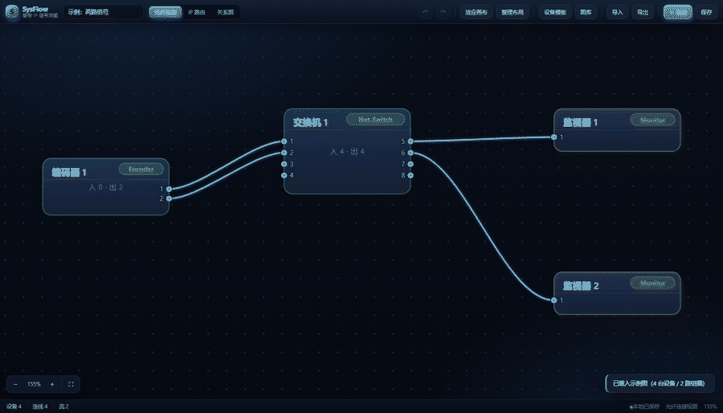

<div align="center">

# SysFlow

**IP系统设计，先出信号流图，再出物理接线图，让基带工程师更容易维护系统**

零依赖 · 单文件 · 离线可用 · 双击即开

</div>

<!-- TODO(agamecat)：demo.gif 目前是占位图。录一段 10 秒左右的真实操作（拖设备 → 拖线连接 →
     双击端口配组播 → 切到「IP 路由」追踪信号流），导出同名 demo.gif 覆盖即可，README 不用改。 -->


## Quick Start

```bash
git clone https://github.com/agamecat/systemflow.git
cd systemflow && open sysflow.html        # macOS；Windows 直接双击文件，Linux 用 xdg-open
```

不想 clone？**在线试用**：<https://agamecat.github.io/systemflow/>

没有 `npm install`、没有构建、没有后端。仓库自带一份**脱敏的示例图**（7 台设备 / 6 条光纤 / 3 路组播，全部虚构）：
打开后点「导入」选 `data/sample-system-diagram.json`，或直接点空画布上的「载入示例」。

## Features

| 能力 | 说明 |
| --- | --- |
| **三种视图** | 光纤连接（物理连线）、IP 路由（按组播追踪）、关系图（自动分层总览，只读） |
| **拖拽布局** | 设备随手拖，坐标与数据本体分离存储，换机器不会打乱拓扑 |
| **端口与组播** | 双击 IP 端口配置收发组播；接收侧由信号连线自动派生；B 口镜像同号 A 口 |
| **信号流追踪** | 按组播地址串起物理链路与转发设备，逐跳推导，断点位置直接标出 |
| **图层切换** | 顶栏一键在光纤 / IP 路由 / 关系图之间切换，切换后自动适应画布 |
| **设备模板** | 内置信号源、IP 交换机、监视器；可自建模板并导入导出 |
| **导入 / 导出** | 图与模板都可导出为 JSON；旧版 SQLite 数据库一键转换成可导入格式 |
| **撤销 / 重做** | 破坏性操作前自动快照，`Ctrl+Z` / `Ctrl+Y`，换图自动清栈 |
| **本地优先** | 数据只存在浏览器 localStorage，不发任何网络请求；清缓存前记得导出 |

## Roadmap

- [ ] **浅色主题 + 出图**：一套高对比浅色皮肤，支持导出 PNG / 打印成 PDF
- [ ] **大图性能**：设备上百台时改为增量渲染与视口裁剪，拖拽保持 60fps
- [ ] **可选协作**：图数据可同步到自建服务（默认仍是纯本地、零网络）

## 文档

- 数据模型（SignalGraph v2）：[`docs/schema.md`](docs/schema.md)
- 开发/交接说明（架构、数据不变式、踩坑）：[`AGENTS.md`](AGENTS.md)
- 示例数据（合成、可复现）：[`data/README.md`](data/README.md)
- 端到端自检脚本：[`tools/e2e.cjs`](tools/e2e.cjs)

## 参与贡献

| 你想做什么 | 去哪里 |
| --- | --- |
| 报告 bug、提功能建议 | [Issues](https://github.com/agamecat/systemflow/issues)（有表单模板，请按提示填写） |
| 问用法、聊想法 | [Discussions](https://github.com/agamecat/systemflow/discussions) |
| 改代码、提 PR | 先读 [`CONTRIBUTING.md`](CONTRIBUTING.md)，里面有代码风格与自检命令 |
| 报告安全漏洞 | **不要公开提交**，走 [`SECURITY.md`](SECURITY.md) 里的私密通道 |

参与本项目即表示同意遵守 [`CODE_OF_CONDUCT.md`](CODE_OF_CONDUCT.md)。

## License

[MIT](LICENSE) © 2026 agamecat
